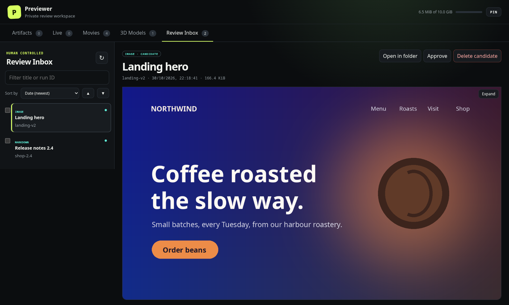
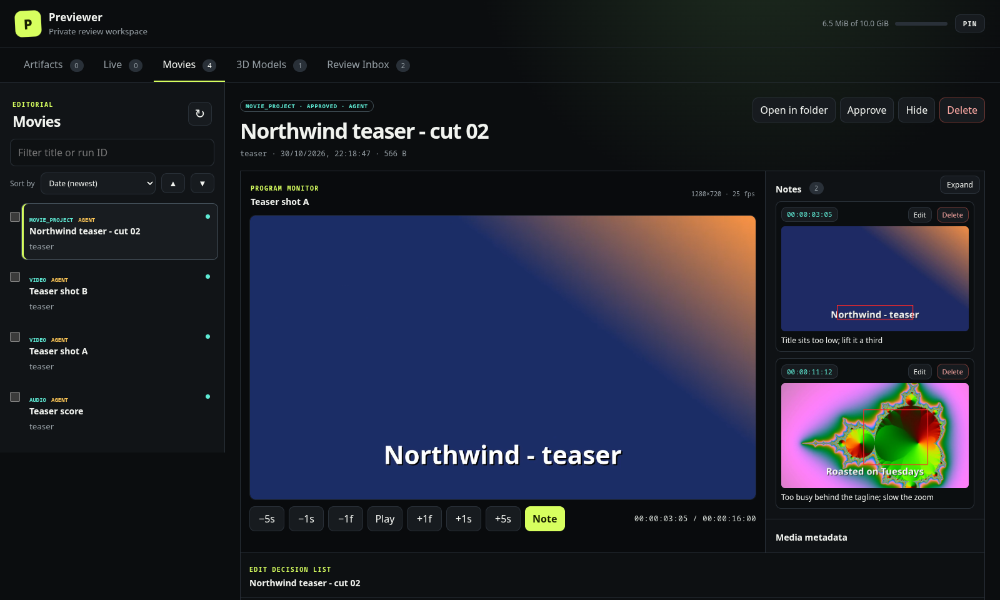
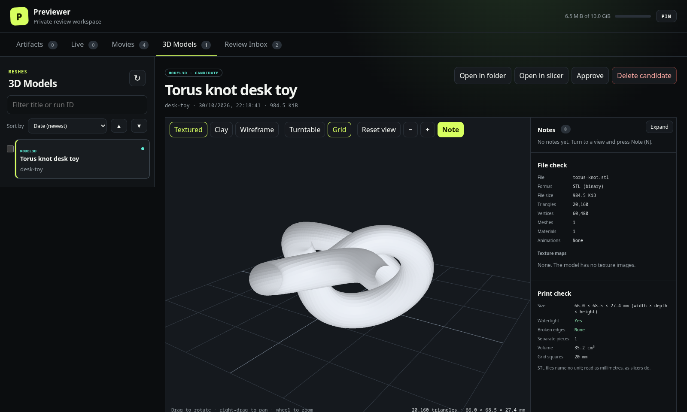

# Agent Previewer

A local review desk for what your coding agents make. Agents submit files, web pages and live URLs from the command line. Previewer checks each one, shows it to you, and keeps nothing as approved until a human approves it.

It works with any agent that can run a shell command: Claude Code, Codex, Cursor, Aider, opencode, or your own scripts.



## What it does

- **Review Inbox.** Every submission lands as a candidate with its verification evidence. You approve, hide or delete it.
- **Verification before review.** Images, video and audio are decoded and checked for blank frames. Markdown, PDFs and HTML are rendered in an isolated Chromium. Live URLs get desktop and mobile screenshots plus declared interaction checks.
- **Immutable approved store.** Approval copies the verified bytes into a read-only store. Every read checks the stored SHA-256 hash. The audit log is append-only.
- **Movies.** Agents submit clips, music and edit manifests. You watch them on a timeline and leave notes pinned to a moment, with a box or freehand mark on the frame. Agents read those notes back with `previewer notes`.
- **3D Models.** A three.js viewer for GLB, glTF, OBJ, STL and 3MF with textured, clay and wireframe views, a file check, a print check (size in mm, watertight, broken edges, volume), notes on camera views, and Open in slicer.
- **Live.** Live URLs and registered noVNC targets, limited to origins you allow.

| Movies | 3D Models |
|---|---|
|  |  |

### Related projects

- [Glance](https://github.com/plivo-labs/glance): self-hosted artifacts on Cloudflare. An agent publishes a page to a URL and you comment in the browser.
- [Decision Desk](https://github.com/jdubb118/decision-desk): a swipeable approve and deny inbox with social-media-style previews.
- [Claude Artifact Viewer](https://github.com/claudecraft/claude-artifact-viewer): a desktop app that renders files dropped into a folder.

Agent Previewer runs only on your machine, checks every submission before you see it, keeps approved copies immutable with an append-only audit log, and covers video and 3D review.

## Requirements

- Linux or Windows 10/11 (see [Windows](#windows)). On Linux, Open in folder uses freedesktop D-Bus and `xdg-open`; on KDE, Previewer also brings the folder window to the front.
- Python 3.12 or newer.
- Chromium for verification: `/usr/bin/chromium`, another browser named in `PREVIEWER_CHROMIUM`, or Playwright's own (`python -m playwright install chromium`).
- `ffmpeg` and `ffprobe` for video and audio, and `pdftoppm` (poppler) for PDFs.
- Optional: PrusaSlicer for Open in slicer.

## Quick start

```bash
git clone https://github.com/neonoodles-ctrl/agent-previewer.git
cd agent-previewer
python -m venv .venv && . .venv/bin/activate
pip install -e .

# Optional: a PIN for approve and delete from other devices
python -m previewer hash-pin          # prints a scrypt hash
export PREVIEWER_PIN_HASH='<printed hash>'

previewer serve                       # http://127.0.0.1:8087
```

From an agent, or any shell on the same machine:

```bash
previewer submit ./hero.png --project-run-id landing-v2 --title "Hero image" \
  --kind image --expected-result "Dark hero with the logo centred"
```

Open `http://127.0.0.1:8087` to review it. Add a line to your agent's instructions (for example `AGENTS.md` or `CLAUDE.md`) telling it to submit finished work this way.

## Security boundary

- The service binds only to loopback. To reach it from a phone or TV, put an authenticating reverse proxy in front of it, such as Tailscale serve.
- Agents can call `POST /api/submit` and read items, receipts, evidence, capacity, and audit events. With `"to": "movies"` (CLI `--to movies`), a verified video, audio or `movie_project` goes straight into Movies, tagged as an agent's. Only requests straight from loopback may set it, because it skips the PIN-gated approve.
- `POST /api/submit` answers only requests straight from this computer. A submission names a local file, so a proxied client, or a page under another Host (DNS rebinding), could otherwise copy any readable file and read it back. Every JSON route also requires `Content-Type: application/json`, which a cross-site page cannot send without a preflight that Previewer never grants.
- A resubmission can clear the agent's own older candidate: `"replaces": "<item id>"` (CLI `--replaces ITEM_ID`) deletes that candidate once the new one verifies ready. It must be a candidate from the same `project_run_id`; approved items and Movies are never touched, and a rejected new item keeps the old one.
- Only `POST /api/human/action` accepts approval, hide, restore, permanent-delete, and movie-edit save actions. Requests straight from loopback need no PIN, because items are copies. Approve and delete from anywhere else, such as a device behind a reverse proxy, need the PIN in `X-Previewer-PIN`; the page asks for it when the server says so. Every action is recorded in the audit log.
- Only a request authenticated with the current PIN can call `POST /api/human/pin` to change it. PIN changes are audited, and raw PINs are never stored.
- Public responses never expose source, staging, or approved filesystem paths.
- `POST /api/items/<id>/show-in-folder` opens the desktop file manager (via `org.freedesktop.FileManager1`, falling back to `xdg-open`) at the submitted original, or at Previewer's copy when the original is gone. On KDE a short KWin script brings the window in front of the browser. The response says only `original` or `copy`, never the path.
- Approval copies verified bytes into a read-only location. Every content read verifies the stored SHA-256 hash.
- Audit events are append-only through SQLite triggers.
- Live URLs and noVNC targets must match `PREVIEWER_ALLOWED_ORIGINS`; noVNC targets must also exist in the target registry.
- Interaction checks are declarative. Shell commands and arbitrary JavaScript are rejected.

## Configuration

| Variable | Purpose | Default |
|---|---|---|
| `PREVIEWER_DATA_DIR` | SQLite, staging, evidence, and approved bytes | `./data` |
| `PREVIEWER_PIN_HASH` | Scrypt human-PIN hash (gates PIN changes, and approve/delete away from loopback) | PIN changes and remote approve/delete disabled |
| `PREVIEWER_ALLOWED_ORIGINS` | Comma-separated exact URL origins | none |
| `PREVIEWER_TARGETS_FILE` | JSON noVNC target registry | none |
| `PREVIEWER_VOLUME_LIMIT_BYTES` | Capacity limit for 80/90% controls | 10 GiB |
| `PREVIEWER_CHROMIUM` | Chromium executable used by Playwright | `/usr/bin/chromium` if present, else Playwright's own Chromium |
| `PREVIEWER_VERIFY_TIMEOUT_MS` | Browser-check timeout | 15000 |
| `PREVIEWER_OPEN_BROWSER` | Set `1` to let `previewer open` launch a browser tab | off |
| `PREVIEWER_SLICER` | Slicer for Open in slicer: a path or a command on `PATH` | `prusa-slicer` |
| `PREVIEWER_URL` | Service URL the CLI talks to | `http://127.0.0.1:8087` |

Generate the initial PIN hash with `python -m previewer hash-pin`. Store only the printed hash in `PREVIEWER_PIN_HASH`. After startup, use the **PIN** button in the top-right of the UI to change it. The current PIN is required; the new PIN must contain 4 to 32 digits. The persistent database hash takes precedence over the bootstrap environment value after a UI change. `targets.example.json` documents the target registry format.

## CLI

```text
previewer serve [--host 127.0.0.1] [--port 8087]
previewer submit FILE --project-run-id RUN --title TITLE --kind image --expected-result TEXT
previewer submit PROJECT.json --project-run-id RUN --title TITLE --kind movie_project --expected-result TEXT
previewer submit FILE --project-run-id RUN --title TITLE --kind video --expected-result TEXT --to movies
previewer submit FILE --project-run-id RUN --title TITLE --kind image --expected-result TEXT --replaces OLD_ITEM_ID
previewer submit --json declaration.json
previewer status [ITEM_ID]
previewer notes ITEM_ID [--out FOLDER]
previewer open [ITEM_ID]
previewer hash-pin
```

Kinds: `image`, `video`, `audio`, `markdown`, `report`, `pdf`, `log`, `subtitle`, `file`, `html`, `live_url`, `novnc`, `model3d`, `blend`, `apk`, `movie_project`.

`previewer notes` prints the reviewer's notes on a movie or 3D model as JSON: `at_seconds`, `text`, `screenshot_url` and, on a 3D model, `view` (camera position, target, view mode and any animation clip). With `--out`, an existing folder, it also saves each screenshot there and adds `screenshot_file`.

`previewer open` prints the UI URL and does **not** launch a browser. Pass `--browser` or set `PREVIEWER_OPEN_BROWSER=1` to open a tab.

The service and CLI must run on the same machine, because a submission names a local file. An agent on another machine can copy the file over with `scp` and run `previewer submit` over `ssh`.

A live declaration can contain only `route`, `selector`, `click`, `text`, and `scroll` checks. A noVNC declaration supplies a registered target ID as its `source`. `.blend` and APK declarations also require `target_id`.

## Movies workspace

Agents submit individual clips as `video`, score or music as `audio`, and complete edit plans as `movie_project`. A plain submission enters the Review Inbox and appears in Movies once a human approves it. With `--to movies`, a submission that passes verification goes straight into Movies with an AGENT tag, the audit log records `placed_in_movies` by `agent`, and it stays out of Artifacts; agent audio lists in Movies because no other tab shows it. One that fails verification lands in the Review Inbox as usual. A version 1 project manifest uses approved or submitted Previewer item IDs:

```json
{
  "version": 1,
  "title": "Launch trailer — cut 03",
  "timeline": {
    "duration_seconds": 30,
    "frame_rate": 24,
    "width": 1920,
    "height": 1080,
    "color_space": "Rec. 709"
  },
  "clips": [
    {
      "item_id": "0123456789abcdef0123456789abcdef",
      "label": "Opening montage",
      "start_seconds": 0,
      "end_seconds": 12,
      "notes": "Lead with the strongest motion."
    }
  ],
  "markers": [
    {
      "type": "music",
      "start_seconds": 2,
      "end_seconds": 18,
      "label": "Score enters",
      "notes": "Fade under dialogue.",
      "asset_item_id": "fedcba9876543210fedcba9876543210"
    }
  ]
}
```

The UI shows manifest clips and music cues on the timeline in four alternating shades, so neighbouring shots stand apart; clicking one jumps to its start. Cut markers are not shown.

Movies has the Review Inbox list tools: the filter, **Sort by** (one setting shared with Review Inbox) and checkboxes with **Delete N selected**. Each Movies item has **Delete**, which removes an approved item and its notes at once, without hiding it first. An item with the AGENT tag also has **Approve**: it becomes a human approval, the tag goes, the audit log records `approved` by `human`, and a video then also lists in Artifacts.

**Notes** (modelled on Voyager's preview annotation): press **Note** under the monitor, or N, to freeze the frame. Drag a box (Box, R) or draw freehand (Draw, D) if you like, type the note, and press Enter to save; Esc cancels. Previewer saves straight away, with no Save step: the note's time, its text, and the whole frame with your marks as a JPEG (at most 1920 px wide). Notes appear as red dots on the Notes track and in the right-hand Notes list, where each one jumps to its moment, can be deleted, or can have its text changed with **Edit** (Enter saves, Shift+Enter adds a line, Esc cancels; the time and screenshot stay). They are stored in the `movie_notes` table and `data/notes/<item_id>/`, apart from the immutable media, and add `note_added`, `note_edited` and `note_deleted` audit events. Deleting the movie deletes its notes. Notes need no PIN.

- `GET /api/items/<id>/notes` lists notes; `POST` with `{"at_seconds", "text", "screenshot": "data:image/jpeg;base64,..."}` adds one (text, screenshot or both).
- `GET /api/items/<id>/notes/<note_id>.jpg` serves a screenshot; `POST /api/items/<id>/notes/<note_id>/edit` with `{"text"}` changes its text; `POST /api/items/<id>/notes/<note_id>/delete` deletes a note.

### 3D models

A `model3d` item (GLB, glTF, OBJ, STL or 3MF) opens in the 3D viewer. 3D models have their own **3D Models** tab, candidates and approved together, with the Review Inbox list tools (filter, Sort by, checkboxes, Delete N selected) and Approve, Hide and Delete; they are not listed in Review Inbox or Live, and Review Inbox's count and Delete N old leave them out. A link to a 3D model opens that tab. The viewer is three.js 0.186.1, copied into `previewer/static/vendor/three/` with its licence; the add-ons' `from 'three'` imports point at the copied build, because the page's script policy blocks an import map. app.js loads it only when a model opens.

- **View:** Textured, Clay and Wireframe; drag to rotate, right-drag to pan, wheel to zoom; − and + zoom out and in; Turntable spins it; Grid shows a floor grid in round millimetre squares; Reset view frames it again. Until the camera is moved, the model is framed again whenever the viewer changes shape, such as on Expand. A glTF with no materials opens in Clay, since glTF's default white metal shows no shape.
- **Animations:** a model with animations plays the first one; pick a clip, play or pause, and drag the time bar.
- **File check:** format, file size, triangles, vertices, meshes, materials, animations, and each texture map with a small preview (maps that share one image, such as metal and roughness, are listed together).
- **Print check:** size in millimetres (width × depth × height), watertight or not with the count of open edges, broken edges (shared by 3 or more faces), separate pieces, and volume when the mesh is watertight. Vertices are welded by position first, since exporters split them at texture seams. glTF is in metres; 3MF states its unit; STL and OBJ are read as millimetres, as slicers do. It reports only and never changes the file.
- **Notes:** Note, or N, freezes the view to mark and type on, exactly as in Movies. A 3D note keeps the camera view, the view mode and any animation clip and time (`view`, with `at_seconds` as the animation time); its row is named View 1, View 2 and so on, and clicking it returns to that view. Notes start on a candidate, so agents can read them before approval. They need no PIN.
- **Open in slicer:** opens the model in PrusaSlicer on this computer, like Show in folder (`PREVIEWER_SLICER`, default `prusa-slicer`). PrusaSlicer reads STL, 3MF and OBJ, so those open directly, the original if it still exists; a glTF model goes as a binary STL the viewer makes, in millimetres with Z up, kept at `data/slicer/<item_id>.stl` until the item is deleted.
- `POST /api/items/<id>/open-in-slicer` with `{}` opens an STL, 3MF or OBJ item; the same route with `Content-Type: model/stl` and a binary STL body (up to 512 MiB) stores and opens a copy.
- Not shown: Draco-, meshopt- or KTX2-compressed glTF, which would need a script-policy change for the decoders; the viewer says so instead. A glTF submitted as a folder opens only once approved, because a candidate's content is served as one file.

The older edit document (`/api/items/<id>/movie-edit`, `save_movie_edit`) still loads manifest clips and saved markers, but the page no longer edits it.

## Verification behavior

- Images, video, and audio are decoded and checked for non-blank visual evidence.
- Markdown, reports, logs, subtitles, and PDFs retain a visible first-page render.
- Static HTML runs in an isolated Chromium context with external requests blocked; its screenshot and console report are retained.
- Live URLs get desktop and mobile screenshots, declared interactions, scroll checks, and console/network reports.
- noVNC requires a registered target and a visible non-blank canvas frame. Previewer never launches the target.
- GLB, glTF, OBJ, STL and 3MF files are structurally checked and shown in the 3D viewer. `.blend` and APK use an attached registered noVNC target.

## Windows

Previewer runs on Windows 10 and 11. It was tested on Windows 11 Pro with Python 3.14 and Chrome. In PowerShell:

```powershell
winget install Python.Python.3.13 Gyan.FFmpeg oschwartz10612.Poppler
# open a new terminal so PATH picks up ffmpeg and pdftoppm
py -3.13 -m venv .venv
.venv\Scripts\pip install -e .
.venv\Scripts\python -m playwright install chromium
.venv\Scripts\previewer serve
```

- Verification uses Playwright's own Chromium unless `PREVIEWER_CHROMIUM` names another browser, such as `C:\Program Files\Google\Chrome\Application\chrome.exe`.
- Open in folder opens Explorer with the file selected.
- Open in slicer needs `PREVIEWER_SLICER` set to PrusaSlicer's `prusa-slicer.exe`, usually in `C:\Program Files\Prusa3D\PrusaSlicer\`.
- Approve and delete work while a video plays: Previewer opens a file only while it reads each chunk, because Windows will not move or delete an open file.

## Development checks

```text
python -m unittest discover -s tests -v
python -m compileall -q previewer tests
node --check previewer/static/app.js
node --check previewer/static/viewer3d.js
node --check previewer/static/print-check.js
```

## License

MIT. See [LICENSE](LICENSE). three.js, bundled in `previewer/static/vendor/three/`, is MIT-licensed by its authors.
